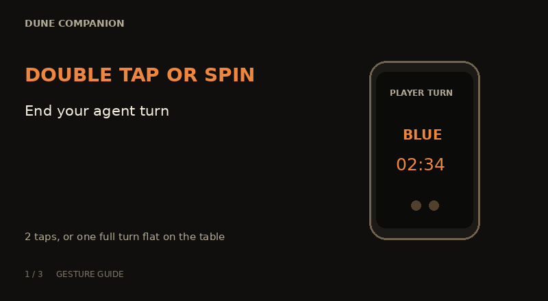
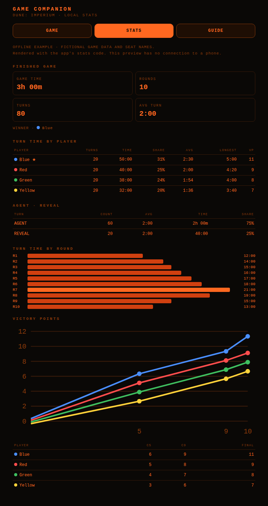
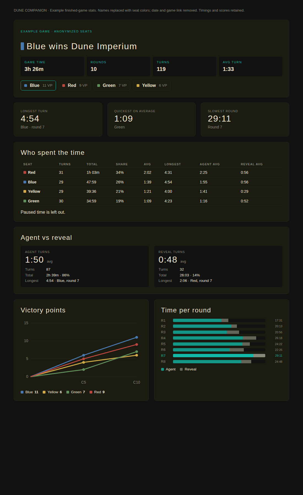

# Dune Companion

An Android companion for **Dune: Imperium and its expansions**, built to track the game, measure time taken
by each player and round, and record stats to look back on after play.

One phone lies on the table, showing whose turn it is and announcing handovers and phases
out loud. Players use taps, spins, shakes and drawn gestures to keep play moving. A second
phone opens a browser panel for setup, scoring, corrections and stats.

*Fan-made. Not affiliated with or endorsed by Dire Wolf or Legendary.*

## At the table



*Illustrated gesture guide. [HTML animation source](docs/gesture-demo.html) ·
[Original promo video](promo/dune-companion-promo-v3.mp4) (shows the earlier controls).*

1. Open the Android app and scan its QR code with a second phone.
2. Set up the players in the browser panel, then lay the display phone on the table.
3. Play the physical game. The companion handles turn timing, spoken handovers and round flow.
4. Review the finished game's stats locally; optionally share an unlisted DubbleG page.

## After the game

The browser panel's **STATS** tab shows your saved games, time per player and round, agent
and reveal turns, and victory-point checkpoints. These stats stay on the phone and work offline.



*The app's local stats layout, illustrated with fictional game data and seat names.
[Open the offline example](docs/local-stats-example.html).*

## Features

- **Gestures on the display phone:**
  - **Spin it a full turn** while it lies face up to end an agent turn. Two half-turns the same
    way also count. It must have been lying still for a second first, so setting it down with a
    twist doesn't count.
  - **Shake it** in the hand to reveal. During combat, a shake marks combat resolved.
  - **Double-tap** to end an agent turn; **triple-tap** to finish a reveal or resolve combat.
    The app waits 400 ms after the last tap to distinguish them.
  - Draw **S**, **C** or **M** to claim Swordmaster, High Council or Mentat for the current player.
- **Voice:** the phone's text-to-speech names whoever has the turn, and calls out phases, turn
  timers (5, 7 and 10 minutes) and hourly game time. Recorded clips replace any line if
  installed.
- **Round flow:** rounds 1–10, conflict tiers, and the automatic makers and recall phases.
  - Swordmaster, Mentat and High Council tracking.
  - Victory-point checkpoints after conflicts 5, 9 and 10.
  - Undo for the last turn and the last round.
- **Admin panel:** served by the display phone on port 8080 to any browser on the same Wi-Fi,
  or on the display phone's hotspot. The display shows a QR code for it between games.
- **Game is saved** on every change, so closing the app or a restart picks up where it was.
- **Victory-point checkpoints** after conflicts 5 and 9, and at the end. The companion asks for
  the scores, and once they are entered it reads the standings back, leader first.
- **Stats:** every game that ends with a winner is saved on the display phone. The panel's
  STATS tab shows the live game and every past game: game time, time per player and per round,
  agent vs reveal turns, and victory points by checkpoint. It also shows all-time wins and
  averages by player name, and has a JSON export. The history is only on the phone, so
  uninstalling the app deletes it.
- **Optional web stats:** host your finished-game stats on a DubbleG webpage to view and share.
  Games stay on your phone unless you choose to share them.
- **Guide:** the panel's GUIDE tab covers setup, gestures, the round flow and troubleshooting.

## Build and install

Requires JDK 17 and the Android SDK (API 34). The app runs on Android 10 or later.
See [test-build distribution](docs/distribution.md) for signing and Firebase setup.

```sh
./gradlew testDebugUnitTest          # rules, gesture and speech tests
./gradlew assembleRelease            # shrunk APK, ~1.4 MB
adb install -r build/outputs/apk/release/dune-companion-release.apk
adb logcat -s DuneTilt DuneAudio     # gesture and audio logs
```

## Using it

1. Open the app on the display phone and allow notifications.
2. Scan the QR code with a second phone and start a game from the panel.
3. Lay the display phone face up on the table.
4. **Long-press** the display to show the gesture debug overlay. It has sensors, live spin
   degrees and fire counts, and an exit button.
5. To close the app, long-press the display and choose **EXIT · KEEP GAME** (clocks pause
   until resumed from the panel) or **EXIT · END GAME** (tap twice; the game is discarded).
   **Stop** on the notification keeps the game.

Recorded clips are optional. Push them to the app's `files/clips/` directory, named as in
`DuneSpeech.kt` (for example `dune_phase_combat.wav`).

## Optional DubbleG stats

DubbleG is a local board game meetup network I created. If you'd like, you can also host your
finished-game stats on a DubbleG webpage and share its unlisted link. Sharing is optional and
off by default; anyone with the link can view the names, scores and timings you share.



*Optional hosted webpage: names replaced by seat colors; date and game link removed.
[Full web stats example](docs/stats-example.html).*

[Connection and sharing details](docs/dubbleg-setup.md).

## Status

An early companion tested at the table; gesture changes still need a device playtest.
The reveal/extra-agent voice reminder remains a [design proposal](docs/voice-reminder-proposal.md).

Earlier sensor tuning: The gestures were tuned on a Pixel 4a (Android 16):

- **Spin:** fires at 300°. Deliberate spins coasted to rest at 314–329°; accidental handling
  never passed about 240°.
- **Shake:** fires at 20 m/s² using the hardware linear-acceleration sensor. Hard tilting
  peaked at 12.9, a real shake at 46–62.

Sensor draw is about 1.7 mA rated, under 0.2% of the battery over a three-hour game.

Not yet verified:

- the panel over a hotspot
- a controlled full-game battery test
- more phone models

Thresholds live in `Config.kt`.

## Licence

Not chosen yet. Until one is added, all rights are reserved.
